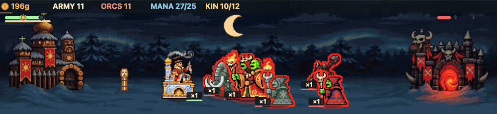
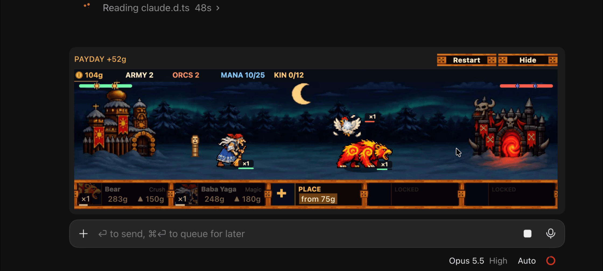
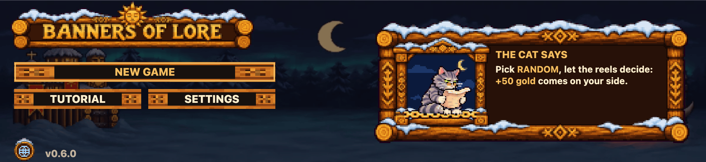
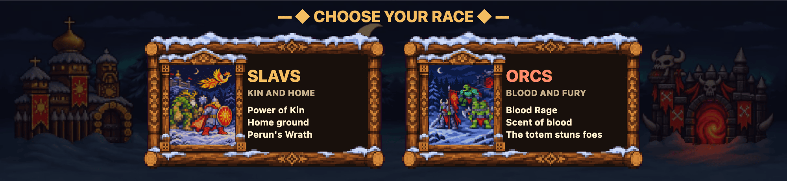
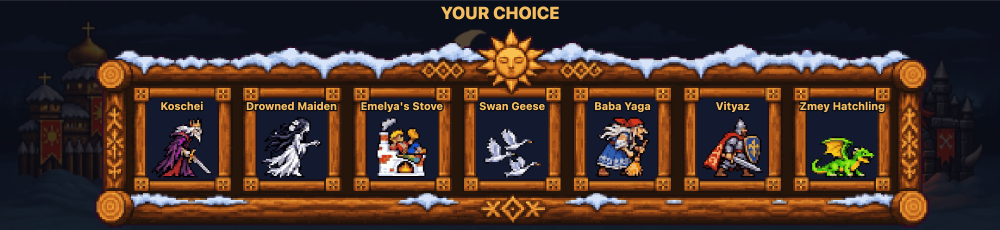
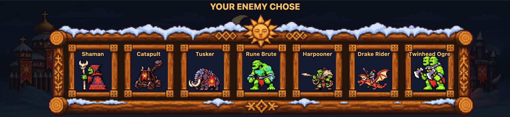
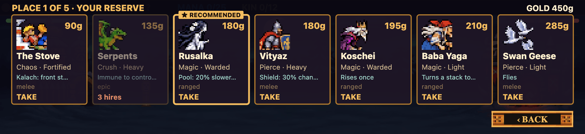
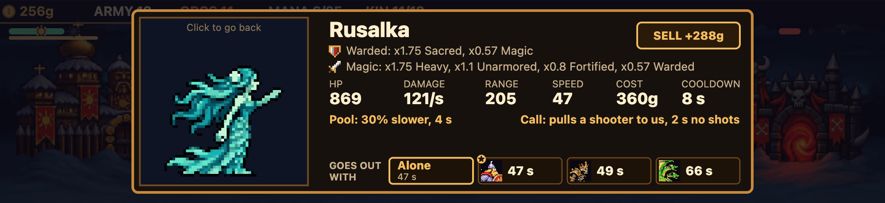
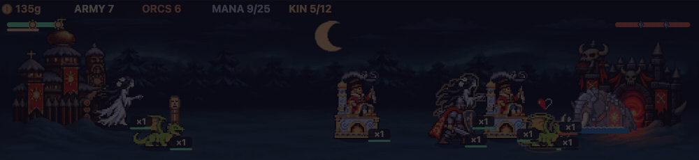
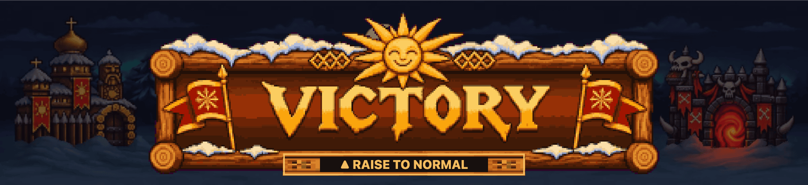

<h1 align="center">Banners of Lore</h1>

<p align="center">
  <b>Play while you’re Clauding.</b><br>
  An autobattler above the prompt: Slavic folklore against orcs. Play either side. The battle runs while Claude works, and Claude's work deals the cards.
</p>

<p align="center">
  
</p>

<p align="center">
  <a href="#install">Install</a> ·
  <a href="#how-it-plays">How it plays</a> ·
  <a href="#troubleshooting">Troubleshooting</a>
</p>

You give Claude a task. While it works, a small war runs in the band above the prompt box. You hire the army with a few clicks, and you can look away at any time: the battle waits when Claude stops.

<p align="center">
  
</p>

## Install

In Claude Desktop, on the Code tab:

1. Click `+` next to the prompt box, then **Plugins**.
2. Choose **Add marketplace** and enter `Nero0909/banners-of-lore`.
3. Choose **Add plugin** and pick Banners of Lore.
4. Open a new session and give Claude a task. The game appears above the prompt while Claude works.

Or from a terminal:

```bash
claude plugin install banners-of-lore --marketplace Nero0909/banners-of-lore
```

On your first run the title offers a short tutorial from the learned cat. The game speaks English and Russian: pick the language in **Settings** on the title.

<p align="center">
  
</p>

## How it plays

**Goal.** Break the enemy's walls before they break yours.

### 1. Choose your race

The Slavs hold the wooden fortress, the orcs hold the gate. Each race fights its own way:

| | Slavs: kin and home | Orcs: blood and fury |
|---|---|---|
| **Fallen warriors** | Fill the Kin bar. At 12, your army heals and hits 30% harder. | Fill the Rage bar. When it is full, your orcs strike twice as fast. |
| **Second power** | Home ground: near your fortress, your warriors take 20% less harm. | Scent of blood: your orcs hit 10% harder at foes below half health. |
| **Mana spell** | Perun's lightning strikes the foe. | The orc totem stuns the foe. |

<p align="center">
  
</p>

### 2. Draft your army

Pick your lines by hand, or let the reels deal them for +50 gold. Each side has 19 lines: tanks, mages, archers, supports and epics. The enemy drafts too, and you see its choice before the fight.

<p align="center">
  
  
</p>

### 3. Hire, upgrade, tie and sell

Gold comes every payday, once in 20 seconds. Each hire lifts the next payday, so gold kept in store earns nothing.

- **Place.** Open five places on the field from your reserve. An epic wakes after you hire enough of the others.
- **Hire and upgrade.** Each line on the hire bar has two prices: the left one adds one more warrior, the right one (▲) makes the whole line stronger.
- **Tie lines.** Click a face on the hire bar to open the line's card. There you choose which line it marches out with, so your archers walk behind your blades.
- **Sell.** The same card sells the line for 80% of the gold you paid. Its warriors on the field fight on.

<p align="center">
  
  
</p>

### 4. Counter the armor

There are five attack types and five armor types. Pierce tears through Light armor (x1.75) and does little to Fortified (x0.57). Click any warrior on the field to see what it hits and what stops it.

### 5. Claude's work joins the fight

| What Claude does | What happens on the field |
|---|---|
| Writes output tokens | Mana fills. At 25 mana your race's spell goes off: Perun's lightning or the orc totem. |
| Adds, edits or deletes lines of code | The die rolls and deals a card: gold, a damage boost, free squads, a thaw that holds an army back. Most cards are good, and deleted lines make the die kinder. |
| A tool call fails | The next enemy wave comes enraged. |
| Compacts its context | Your army is stunned and stands still. |

<p align="center">
  
</p>

### 6. Win or fall

Each side's walls strike twice in a match and kill everyone who stands at them. A match takes about 5 to 13 minutes of Claude's work. There are three levels: Easy, Normal and Hard. After a match the end screen offers to raise or lower the level.

<p align="center">
  
</p>

## What you need

- Claude Desktop, for the full picture. In a terminal the game shows text and buttons only.
- Any system Claude Desktop runs on: macOS 13 or newer on Apple Silicon or Intel, Windows 10 or 11 on x64 or ARM64, or Linux (Ubuntu 22.04+ or Debian 12+) on x64 or arm64.

## Troubleshooting

**The game does not appear.** It shows on the Code tab only, in a session opened after the install. Open a new session and give Claude a task. If the band is still empty, type `/reload-plugins` in the chat.

**I see one row with a Show button.** The band is folded. Click **Show**. **Hide** folds it again and pauses the battle.

**The battle stands still.** The war runs only while Claude works. Give Claude a task, and it goes on from where it stood.

**I see text and buttons, no pictures.** You are in a terminal. The pictures need Claude Desktop.

**The title says a new version is out.** Click the notice: it copies the update command. Run it in a terminal, then type `/reload-plugins` in the chat.

```bash
claude plugin update banners-of-lore@banners-of-lore
```

**I want to start over.** Click **Restart** in the corner of the band.

**Something else is wrong.** [Open an issue](https://github.com/Nero0909/banners-of-lore/issues). Say your system and the game's version from the title. If a match went wrong, attach its record from `~/.claude/banners-of-lore/matches` (on Windows, `%USERPROFILE%\.claude\banners-of-lore\matches`).

## What the mod does on your computer

- Runs the game inside Claude: the core is JavaScript in `hooks/core`. The mod contains no program files.
- Keeps the match in Claude's data.
- Writes match records to `~/.claude/banners-of-lore/matches` (on Windows, `%USERPROFILE%\.claude\banners-of-lore\matches`). If it cannot find your home folder, it writes them to `matches` in the mod's own folder.
- Once a day, reads this repository's `.claude-plugin/plugin.json` from GitHub to learn the newest version. The title then shows it, and a click on it copies the command that updates the mod. Nothing is sent but the request for that file.
- Starts these programs, and no others:
  - `printenv HOME` on macOS and Linux, to find your home folder for the match records;
  - your system's link opener (`open`, `xdg-open` or `cmd /c start`), when you click a link on the title.

The game's sources are not in this repository: `hooks/core` holds the game compiled to JavaScript, the same files on every system.

## How it was made

The game's rules are written in Rust and compiled to JavaScript. The code was written with Claude Code. The art was generated with ChatGPT and PixelLab, then cut into sprites and cleaned.

## Remove

Open **Plugins** in Claude Desktop and remove Banners of Lore, or run:

```bash
claude plugin uninstall banners-of-lore@banners-of-lore
```

## License

Copyright 2026 Nikita Makarov. The mod is free for personal, noncommercial use under the [PolyForm Strict License 1.0.0](LICENSE). You may not redistribute it, sell it or change it. Paid content, if it comes, will have terms of its own.
